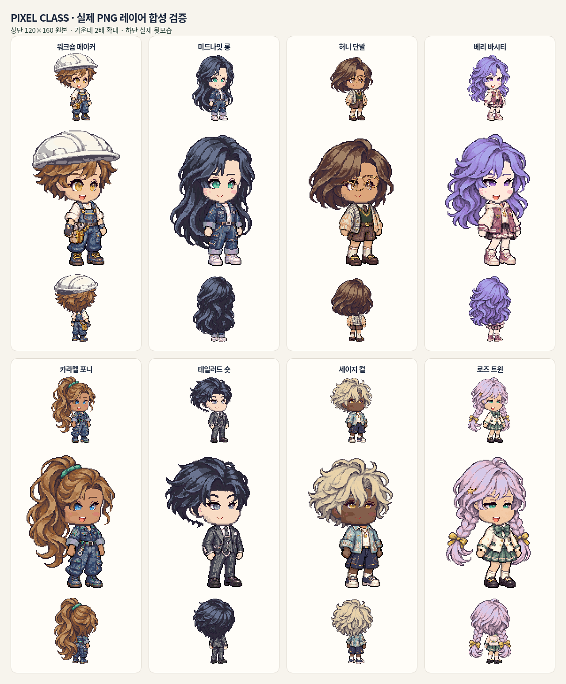
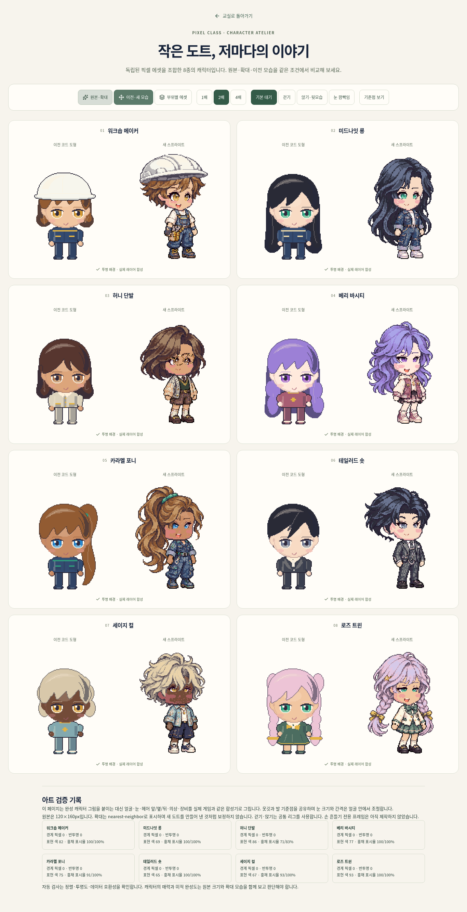

# PIXEL CLASS 캐릭터 아트 전면 재설계 결과

작성: 2026-11-16 KST. 작업 브랜치 `feat/sprite-asset-redesign`, 기준 main `5fa3b7776bd6755d6f0e3610a064b773d5afa46f`.

## 바뀐 결과

기존 코드 도형 렌더러를 기본값에서 내려놓고 **독자적인 PNG 레이어 아트**를 제작·합성했습니다. 캐릭터8종을 실제 커스터마이징·가입·교실·저장 API에 연결했습니다. 아트 비교 갤러리는 **`/character-art`**이며 꾸미기 창의 **8종 아트·전후 비교 보기** 링크로 열 수 있습니다. 운영 입구의 접근 제한은 그대로 적용됩니다.

얼굴4종, 열린 눈8종과 감은 눈, 헤어8종, 의상8종, 눈썹4종, 입4종, 액세서리7종을 독립적으로 선택합니다. 눈 크기/간격·홍채색·피부·체형·표정·안전모·의상색도 분리했습니다. 기존 의상25종/모자15종의 선택 경험은 **이전 캐릭터 스타일**에 보존하며, 신규 PNG 의상8종을25종으로 부풀려 보고하지 않습니다.

## 제작과 검토 반복

| 단계      | 실제 발견한 문제                                               | 수정 및 증거                                                            |
| --------- | -------------------------------------------------------------- | ----------------------------------------------------------------------- |
| 기존      | 큰 원형 얼굴, 공통 머리 덩어리, 평평한 옷, 유사한 눈           | 원본 렌더러를 보존하고 별도 PNG 아트/합성기 설계                        |
| 1차 합성  | 피부 양자화 얼룩, 옷깃과 턱 어긋남, 헤어 가림 불일치           | 재질별 피부 명암·턱/옷깃 앵커 재설정. `reviews/cycle-1-layers.png` 비교 |
| 2~3차     | 작은 눈의 위치와 소스 눈 사이 여백 불일치                      | 홍채/눈썹 splitX와 얼굴별 eyeY, 크기·간격 리그 적용                     |
| 4차       | 헤어 전체가 한 레이어여서 모자와 충돌                          | 앞/옆/뒤 및 모자 착용 조각, 후면 의상·모자 실제 제작                    |
| 5차       | 샘플 두 개가 같은 열린 눈 사용, 짙은 피부의 홍조가 과함        | 추가 열린 눈 PNG 제작, 피부색에 따른 홍조 강도 조정                     |
| 제품 검토 | 노트북 모달 상단 잘림, 모바일 옵션 선택 시 미리보기 사라짐     | 낮은 화면의 높이 예산과 모바일190px sticky 미리보기/저장 영역           |
| 회귀      | v1 저장 후 v2 눈·헤어 복구 누락, 창 닫은 뒤 방향키 페이지 이동 | 마지막 v2를 별도 보존/복구, 복귀한 아바타 버튼의 게임 방향키 처리       |

`source/art-direction-eight.png`는 최초 콘셉트이며 최종 합성 결과로 대신 보고하지 않습니다. 최종 이미지는 `samples/composed-0..7.png` 및 `reviews/final-layers.png`입니다. 에셋 제작 과정과 규격은 [CHARACTER_ART_SYSTEM.md](CHARACTER_ART_SYSTEM.md)에 기록했습니다.

## 8종의 차이와 평가

| 샘플          | 의도와 실제 구별점                                        | 남은 시각적 과제                                                 |
| ------------- | --------------------------------------------------------- | ---------------------------------------------------------------- |
| 워크숍 메이커 | 부드러운 골드 눈·짧은 머리·무지 안전모·도구가 달린 작업복 | 모자 주름/단추의 작은 색 밀집을 더 줄일 수 있음                  |
| 미드나잇 롱   | 맑은 아몬드 눈·긴 흐름·남색 작업복                        | 긴 앞머리가 눈꼬리를 일부 가림                                   |
| 허니 단발     | 낮은 단발 볼륨·둥근 눈·안경·카디건                        | 안경의 실제 홍채 가시 비율71/83%; 작은 교실에서는 프레임이 강함  |
| 베리 바시티   | 고양이 눈·웨이브·재킷/스커트                              | 웨이브 장식 밀도가 원본에서 다소 높음                            |
| 카라멜 포니   | 나른한 눈·왼쪽 큰 포니 실루엣·벨트 작업복                 | 좌우 반전 시 헤어 양감까지 바뀜; 전용 옆모습 필요                |
| 테일러드 숏   | 날렵한 눈·앞으로 흐르는 숏컷·정장/구두                    | 정장 재질의 미세 픽셀은 작은 크기에서 합쳐짐                     |
| 세이지 컬     | 새 꽃잎 눈·은빛 컬·짙은 피부·가벼운 셔츠                  | 앞머리에 따른 눈 가림은 남으며 피부/의상 명암의 수작업 정제 여지 |
| 로즈 트윈     | 반짝이는 눈·분리된 양갈래·리본/별·교복                    | 귀·장식 일부 조합은 가까운 색에서 대비가 낮아짐                  |

얼굴 윤곽은4종을 공유하고 8개의 다른 열린 눈·헤어·의상·팔레트로 개성을 만들었습니다. 얼굴을8개 새로 그렸다고 주장하지 않습니다. 원본 크기에서 실루엣과 눈동자를 구별할 수 있으나, 교실 축소 표시에서 모든 단추와 속눈썹까지 읽힌다는 뜻은 아닙니다. **아트 완성도99% 또는 상용 RPG 전 프레임 완성을 선언하지 않습니다.**

디렉터 자체 평가는 눈 자연스러움3.5/5(다단 홍채와 하이라이트, 안경/앞머리 가림 잔존), 얼굴 비율3.5/5(4개 턱선과 목 연결, 일부 미세 피부 톤 정제 필요), 헤어4/5(8개 구분되는 실루엣과 후면, 측면 원화 미제작), 픽셀 완성도3.5/5(이진 alpha·네이티브 도트, 의상 색 밀도 높음), 개성4/5(8개 눈·헤어·의상 조합), 축소 가독성3.5/5(실루엣은 구별되나 미세 장식 소실), 레이어 정렬4/5(발/턱/홍채와768경계 조합 검사)입니다. 수치는 검토 의견이며 사용자 조사나 객관적인 완성률이 아닙니다.

## 실제 화면·검사 범위

- 갤러리: `qa/gallery-{1366,1280,390}.png`, 전후 비교: `qa/comparison-{1366,1280,390}.png`.
- 실제 교실/꾸미기: `product/classroom-*.png`, `product/studio-*.png` — 1920×1080·1440×900·1366×768·1280×720·390×844.
- 5개 화면 가로 넘침0, 꾸미기 axe A/AA 위반0. 데스크톱은 상단/이름/저장 영역 접근, 모바일은 옵션 스크롤 중 미리보기·이름 유지. `product/measurements.json`의 before/after는 **같은 새 UI에서 자동 접근성 검사 실행 전후**이며, 옛 디자인 전후라는 의미가 아닙니다.
- 샘플8개: 부분 alpha0·캔버스 경계 픽셀0·얼굴 바깥 홍채0, 홍채 기준선 차이≤1px. 가림과 색 수는 `qa/sample-diagnostics.json`에 그대로 기록합니다. 보이는 두 눈을 위한 정렬 검사이지 미적 품질의 자동 판정은 아닙니다.
- 얼굴4×헤어8×눈 크기3×간격3=288조합, 샘플8×체형4×모자2×방향4×프레임3=768조합. 전 카탈로그의 이미지가 실제로 달라지는지 검사합니다. 모든 색/표정/장비의 카테시안 곱을 전수 수작업 검사한 것은 아닙니다.

## 데이터와 운영 보호

계정·학교·책상·프로젝트·SQLite 스키마·권한 경로는 보존했습니다. 새 외모 데이터는 기존 Appearance에 버전 필드만 더하며, 읽기 매핑은 DB를 쓰지 않습니다. MASTER/STUDENT 실제 테스트 계정으로 저장·유효성 오류·새로고침·서버 재시작·이전 스타일 복귀를 검사합니다. 옛 렌더러의 기준 PNG와 RGBA 차이0을 유지했습니다.

## 검증 및 배포 기록

최종 전체 재검사와 CI/실제 배포 결과는 작업 종료 전에 이 절과 STATUS.md에 기록합니다. 현재 진행 중인 검사를 완료로 간주하지 않습니다.

## 성능과 남은 작업

이미지 생성은 런타임에 하지 않습니다. 네이티브120×160·외모당13텍스처를 유지하며, 최근8색 조합/부위 팔레트와128개 UI 완성 이미지로 캐시를 제한했습니다. 원본 그림은 Docker 빌드 컨텍스트에서 제외됩니다. 아트 데이터 때문에 기본 entry gzip은 이전 약127KB에서 약254KB로 증가했습니다(Phaser 별도 약357KB gzip은 기존과 같음). 이 증가를 숨기지 않으며 다음 최적화는 동기 초기 미리보기를 유지하는 에셋 분리 로딩입니다.

교실의 실제 측면 원화·손 흔들기·관절을 새로 그린 걷기 전용 프레임·자동 눈 깜빡임은 후속 작업입니다. 현재 걷기/앉기는 공통 리그 변형입니다. 발 위치·가구 충돌은 검사하지만 원화 전용 동작과 동등하다고 주장하지 않습니다. 자동 테스트와 접근성 검사는 매력/귀여움의 사용자 평가를 대신하지 않습니다.
