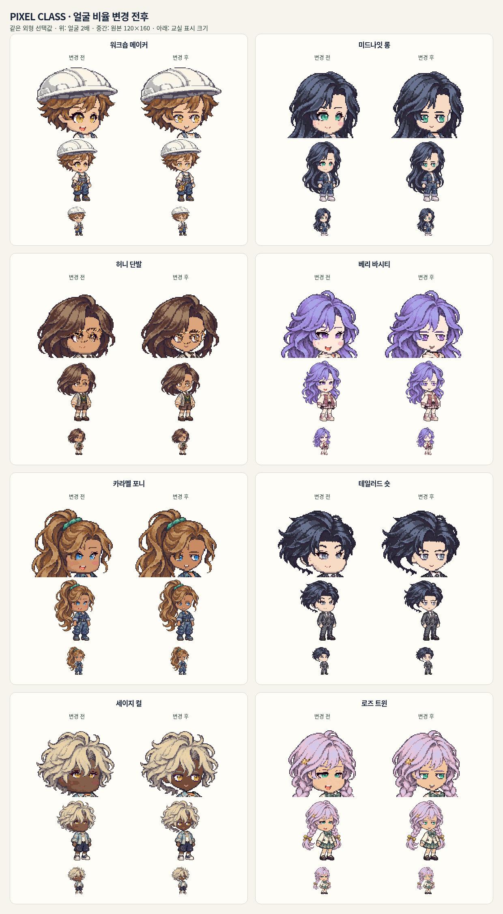
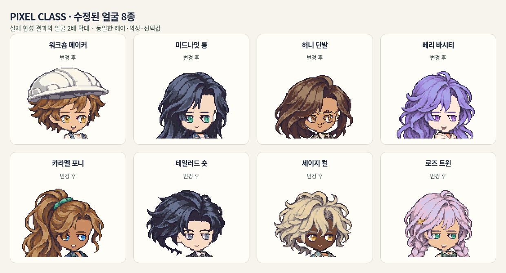

# 캐릭터 얼굴 비율 보완 — 2026-11-17

기준 main `96680b7`, 작업 브랜치 `fix/avatar-face-proportions`. 얼굴이 따로 붙은 듯 보이는 눈의 원근 차이, 넓은 아래 볼, 겹쳐 보이는 윗눈꺼풀, 입 주변의 붉은 픽셀을 함께 수정했습니다. 계정·학생·프로젝트·저장된 외모 선택값은 변경하지 않습니다.

## 실제 수정

| 부위      | 변경 내용                                                                                                                               |
| --------- | --------------------------------------------------------------------------------------------------------------------------------------- |
| 눈        | 서로 다른 크기의 눈 둘을 그대로 붙이는 대신 한 눈의 원화를 기준으로 눈 쌍을 재구성. 가까운 눈14px·먼 눈13px, 동일한 높이·시선·조명 적용 |
| 눈꺼풀    | 원화 위쪽의 두꺼운 눈두덩 부분을 분리해 눈썹과 겹쳐 보이는 층을 줄임. 9개 눈매 ID와 홍채색 선택은 유지                                  |
| 얼굴형    | 새4개 PNG 윤곽을 적용. 폭64→60px, 부드러운 볼에서 작은 턱으로 이어지는 윤곽. 턱 기준86→83px                                             |
| 배치      | 눈 쌍 시작49px·높이61/62px·입75px로 함께 정렬. 눈 간격은 한 단계당 양쪽 각1px로 제한해 과도한 벌어짐 방지                               |
| 입        | 최대8px였던 입을4~6px로 정리. 작은 미소는5×2px의 연결된 모양이며, 피부 명도에 맞는 두 입 색 중 읽기 좋은 색을 선택                      |
| 피부      | 새 얼굴 베이스에는 홍조/잡티를 넣지 않음. 모든 얼굴 픽셀을 피부 재질로 분류해 따뜻한 테두리 색이 붉은 점으로 바뀌지 않도록 처리         |
| 눈썹·안경 | 눈썹도 같은 원화로 쌍의 크기/높이를 맞추고2~3px 높이로 정리. 기존 안경 PNG는 유지하고 새 눈 위치에 맞게 앵커 조정                       |

120×160 원본과 교실55.2×73.6 표시 크기, 발(70,156)·옷깃(70,82)·충돌 좌표는 유지합니다. CSS 블러나 표시 해상도 증가로 변경한 것이 아닙니다. 몸·헤어·장비 PNG **82개는 이전 SHA와 정확히 동일**하며, 새로 바뀐 것은 얼굴·눈·눈썹·입의21개 레이어입니다. v2 외형 ID와 DB 구조, 이전 v1 렌더러를 보존합니다.

## 검토 반복과 증거

1. 작업 전8종과 원래 리그/눈 데이터를 `before/`에 보존했습니다.
2. 첫 시안은 눈의 크기를 맞췄지만 둥근 테두리가 안경알처럼 보여 채택하지 않았습니다. `after/cycle-1.png`, `source/rejected-single-eyes.png`는 **미채택 시안**입니다.
3. 부드러운 원화의 눈매를 살려 쌍을 구성하고, 두꺼운 윗눈꺼풀 층과 눈썹의 중복 인상을 줄였습니다. `after/cycle-2.png`, `after/cycle-3.png`, `after/cycle-4-comparison.png`에 중간 검토를 남겼습니다.
4. 큰 눈/넓은 간격 조합에서 홍채가 얼굴을 벗어나는 회귀를 발견해 간격 범위를 조정했습니다. 피부 `#9b674b`에서 작은 입 대비가1.37에 그치는 실패도 먼저 재현한 뒤 색 선택을 고쳤습니다.
5. 추가 검토에서 기존 진단의 좌표 반올림이 실제 nearest-neighbor 픽셀 일부를 놓치는 것을 발견했습니다. 정면·옆 방향의 실제 합성 홍채 픽셀로 실패를 먼저 재현하고, 진단도 렌더러와 같은 역방향 샘플링으로 수정했습니다. 눈의 시작점을49px로 맞추고, 얼굴 윤곽은 그대로인데 옆 방향에서만 눈·안경을1px 옮기던 보정을 제거했습니다. 이로써 최대 크기·간격에서도 얼굴 안에 들어오고 포니테일의 양쪽 홍채 가독성도 기존 기준50% 이상을 유지합니다.
6. 원본·얼굴2배·교실 표시 크기를 같은 페이지에서 비교했습니다. 최종 결과는 `comparison.png`, `after/faces-eight.png`이며, 생성 원화 자체를 최종 합성 화면으로 대신 보고하지 않습니다.

새 원화는 이미지 생성 도구로 제작·편집했습니다. 실제 게임 출력은 독립된 PNG를 컴파일한 팔레트/RLE 합성입니다. 얼굴·눈의 모양을 도형으로 임시 대체하지 않았습니다. 미적 완성도99%나 모든 사용자 취향에 대한 합격을 선언하지 않습니다.

## 검증

- 새 유닛2개: 원본의 과도한 먼 눈 폭을 재현하고 새9종의 폭 비율·높이·시선을 검사, 피부 재질/턱선/작은 입·82개 기존 PNG 보존 검사.
- 새 브라우저2개: 얼굴4×눈매9×크기3×간격3×방향2=**648조합**에서 홍채 이탈/경계/부분 투명도0, 피부8종의 작은 입 대비 최소**2.62** 확인. 이는 얼굴 요소 가독성 검사이며 WCAG 텍스트 적합성 판정은 아닙니다.
- 새 고해상도 원화가 JS 가변 인수 한도를 넘는 컴파일 오류를 재현했고, 연결 성분을 순회 복사하도록 수정해 실제 아틀라스4개 추출을 검사했습니다.
- 초기 전체 실행은 유닛/API155개·브라우저73개·Docker HTTPS3개 모두 통과했습니다. 마지막 픽셀 진단 보강 후에는 강화한2개 검사를 통과했고, 최종 전체 회귀 검사를 다시 실행하고 있습니다.
- 회귀 검사 대상은 **기존227 + 신규4 =231개**입니다. 최종 코드의 로컬 결과·GitHub CI·실제 배포는 완료를 관측한 뒤 아래에 별도로 확정합니다.

5개 해상도 실제 교실/꾸미기 화면은 `docs/face-proportions/product/`에 저장합니다. 갤러리/기하 검증과 별도로 수작업으로 얼굴을 확대해 평가했습니다. 자동 검사만으로 귀여움이나 자연스러움을 보장하지 않습니다.

## 남은 범위

헤어의 실루엣과 의상은 유지했으므로 앞머리가 눈의 일부를 가리는 스타일은 있습니다. 좌우는 기존 쿼터 뷰 반전이며 전용 옆모습 원화·손 흔들기는 이번 작업에 추가하지 않았습니다. 운영 소유자 로그인/인증 WSS를 새로 검증했다고 주장하지 않습니다.
