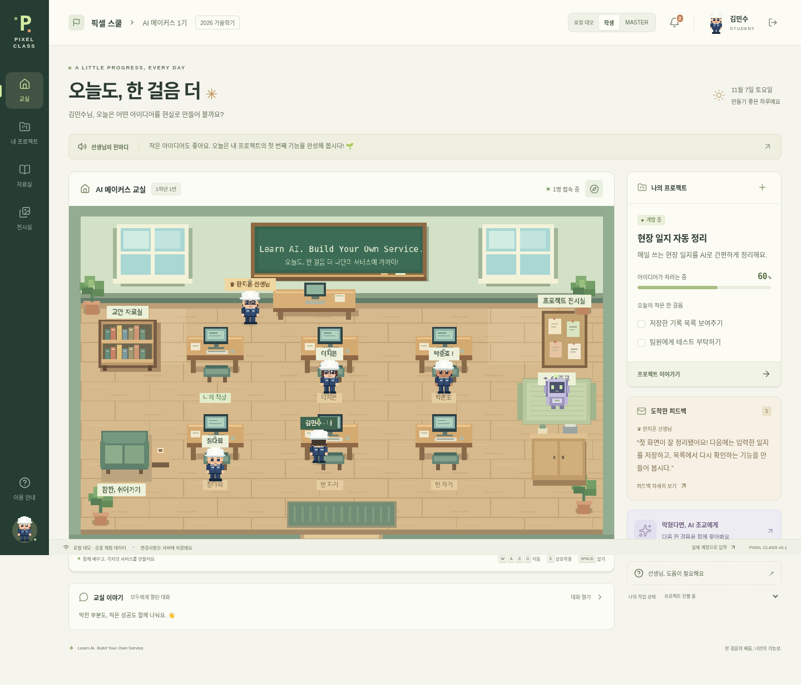

# Pixel Class

**Learn AI. Build Your Own Service.**

건설현장 팀원들이 AI로 자신만의 서비스를 만드는 픽셀 메타버스 학교입니다. 교실에서 걷고, 자기 책상을 열어 프로젝트를 진행하고, MASTER에게 질문과 피드백을 주고받습니다. 주요 UI는 한국어입니다.



## 빠르게 실행하기

Node.js **24 이상**과 npm이 필요합니다. 저장소 루트에서 실행하세요.

```sh
npm ci
npm run dev
```

브라우저에서 **http://localhost:5173**을 여세요. API는 `127.0.0.1:3001`입니다. 개발 프록시가 API와 WebSocket을 같은 출처로 연결합니다.

설정이 없는 개발 실행은 **로컬 데모**입니다. 첫 접속은 학생 체험 계정이며 상단 **학생 / MASTER** 버튼으로 역할을 바꿀 수 있습니다. 체험 계정의 변경사항은 같은 로컬 서버의 접속자에게 공유됩니다. 실제 교육 데이터는 데모에 입력하지 마세요.

- WASD / 방향키: 이동
- 빈 바닥 클릭: 해당 방향으로 이동 (가구를 자동 우회하는 경로 탐색은 없음)
- 책상 클릭 또는 가까이에서 E: 프로젝트 / 공개 프로필 열기
- 책상 근처에서 SPACE: 앉기 / 일어나기
- 책장: 자료실, 게시판: 전시실, 보라색 로봇: AI 조교
- 왼쪽 아래 캐릭터: 외모 수정

## 할 수 있는 일

- 레이어로 그리는 48×64 캐릭터, 고정된 흰색 무지 안전모와 남색 작업복, 이름표
- 이름·체형·피부·머리·눈·눈썹·표정·입·안경/장식 설정과 실시간 미리보기
- 학생 개인 프로젝트 생성·수정·삭제, 할 일·진행률·개발 기록·질문·검토 요청
- MASTER 프로젝트 현황, 비공개 내용 열람 및 피드백·검토 승인
- 7일 유효한 1회용 입학 KEY, 계정 등록, 빈 책상 자동 배정
- 학적 변경과 처리자·사유·날짜 기록, 휴학·복학·졸업·권한 회수
- 교실 WebSocket 이동 동기화·접속 표시·채팅, MASTER 전체/개별 공지
- 교안 검색·업로드·새 버전·다운로드, PDF/이미지 별도 탭 미리보기
- 승인된 공개 프로젝트 전시
- 프로젝트별 OpenAI 조교 연결 코드, 미설정 안내, 대화/오류 저장, 일일 호출 제한
- 향후 Windows 캐릭터 앱이 사용할 개인 이벤트 피드와 수신 확인 API

현재 제공되는 저장소는 **로컬 SQLite 서버**입니다. Supabase Auth/Postgres/Realtime/Storage 연동은 구현하지 않았습니다. 서버 API를 통하지 않고 DB를 공개하지 않으며, 모든 데이터 접근에 서버에서 학교·계정·역할·학적·소유권을 검사합니다. [STATUS.md](STATUS.md)에 완료/부분 구현/미구현을 구분했습니다.

## 나만의 비공개 학교 만들기

데모 계정과 실제 계정은 별도 DB를 사용합니다. 실행 중인 데모 서버를 종료하고:

```sh
npm run setup:private
npm run dev
```

1. 로컬에 생성된 `.env`의 `MASTER_BOOTSTRAP_KEY` 값을 확인합니다. 비밀 파일이므로 Git에 넣지 않습니다.
2. 첫 화면의 **MASTER 등록**에서 KEY, 이름, 이메일, 10자 이상 비밀번호를 입력합니다.
3. MASTER는 **교무실 → 입학 초대**에서 KEY/링크를 발급합니다. KEY 원문은 발급 직후에만 보입니다.
4. 학생은 링크에서 자기 계정과 캐릭터를 등록합니다. 프로젝트가 없어도 입장할 수 있습니다.
5. MASTER 등록 후 부트스트랩 KEY를 서버 설정에서 제거해도 됩니다. 이미 등록된 MASTER를 다시 만들 수 없습니다.

설정 도구는 기존 `.env`를 덮어쓰지 않습니다. 기존 파일이 있다면 `DEMO_MODE=false`, `DATABASE_PATH=data/school.sqlite`, 임의의 충분히 긴 `MASTER_BOOTSTRAP_KEY`를 직접 설정하세요. 데모 DB를 비공개 학교로 잘못 사용하는 경우 서버가 시작을 거부합니다.

이 로컬 인증은 이메일 주소를 로그인 식별자로 사용합니다. **이메일 소유권 인증, 비밀번호 재설정, MFA, OAuth는 없습니다.** 외부 공개 운영 전에는 관리형 인증으로 전환하거나 해당 기능과 운영 보안을 보강해야 합니다.

## 데이터와 백업

- 데모 기본 DB: `data/demo.sqlite`
- 비공개 학교 기본 DB: `data/school.sqlite`
- `.env`의 `DATABASE_PATH`로 변경 가능
- 계정·캐릭터·프로젝트·피드백·파일·학적 이력·초대 해시·세션이 DB에 저장됩니다.
- SQLite WAL 모드입니다. 실행 중인 DB 파일 하나만 복사하지 마세요. 서버를 중단한 뒤 DB 및 관련 파일을 백업하거나 SQLite의 일관된 백업 기능을 사용하세요.
- 브라우저 새로고침이나 서버 재시작으로 데이터가 사라지지 않습니다. 개발 서버의 환경 자체가 삭제되는 경우는 별도 백업이 필요합니다.
- 프로젝트 진행률은 할 일 완료율입니다. 접속/PC 사용 시간과 무관합니다.
- `data/`, `.env`, 테스트 산출물은 Git에서 제외됩니다.

## AI 조교 연결

`.env` 또는 서버 환경 변수에 `OPENAI_API_KEY`, `OPENAI_MODEL`을 설정하고 서버를 다시 실행하세요. `OPENAI_MODEL`은 계정에서 접근할 수 있는 Responses API 지원 모델을 지정합니다. 키를 `VITE_` 변수로 만들지 마세요.

서버가 OpenAI Responses API를 호출합니다. 프로젝트 정보와 최근 대화 최대 10개를 보내며 원격 저장을 끄도록 요청합니다. 개인별 분당 5회, UTC 날짜 기준 일일 20회, 응답당 최대 1,200 출력 토큰, 30초 타임아웃을 적용합니다. 호출 실패도 일일 횟수에 포함됩니다. 실제 비용 상한은 공급자 계정에서도 별도로 설정하세요.

API 키가 없을 때는 허구의 AI 답변을 보여주지 않습니다. 현재 Cloud 환경에는 키가 없어 **실제 모델 호출은 검증하지 않았습니다**. OpenAI API 접속을 허용하는 네트워크도 필요합니다. AI는 참고 조언이며 MASTER 피드백 및 실제 코드 검토와 구분됩니다.

## 검증

```sh
npm run typecheck
npm run build
npm test
npm run test:e2e
npm run format:check
```

Playwright는 이 Cloud 환경의 `/usr/bin/chromium`을 사용합니다. 다른 OS에서는 Chromium을 설치하고 `CHROMIUM_PATH`에 실행 파일의 절대 경로를 지정하세요. 테스트 서버는 임시 DB와 별도 포트(3011: API 테스트, 3012/5174: 브라우저 테스트)를 사용해 작업 데이터를 변경하지 않습니다.

검증 범위와 결과는 [STATUS.md](STATUS.md)를 확인하세요. Playwright HTML 보고서는 `playwright-report/`, 실패 시 추적 파일은 `test-results/`에 저장됩니다.

## 빌드와 배포

```sh
npm run build
NODE_ENV=production DEMO_MODE=false npm start
```

프로덕션 모드는 Express가 `dist/`를 직접 제공합니다. `http://localhost:3001`에서 실행 결과를 확인할 수 있습니다. 최초 MASTER를 만들려면 위 비공개 학교 설정이 먼저 필요합니다. 프로덕션에서는 데모 로그인 API가 비활성화됩니다.

현재 서버는 **지속적인 디스크와 WebSocket을 지원하는 단일 Node.js 호스트**가 필요합니다. HTTPS 역방향 프록시 뒤에서 `COOKIE_SECURE=true`, `PUBLIC_ORIGIN=https://실제-도메인`을 설정하고 WebSocket 업그레이드를 전달하세요. 단일 프로세스용 메모리 요청 제한과 로컬 디스크 저장이므로 여러 인스턴스로 그대로 복제하지 마세요.

**현재 형태를 Vercel 정적 사이트/일반 함수에 그대로 배포하면 저장과 WebSocket이 동작하지 않습니다.** Vercel 배포를 위해서는 Supabase 데이터·인증·스토리지·실시간 어댑터 전환이 선행되어야 합니다. 이번 결과는 외부에 공개 배포하지 않았고 기존 Supabase 프로젝트도 변경하지 않았습니다.

## 구조와 후속 개발

- `src/`: 한국어 React UI, 인증·프로젝트·교무실·자료실
- `src/game/`: Phaser 교실, 충돌, 이동·보간, 직접 제작한 픽셀 맵/레이어 캐릭터
- `server/`: Express API, 세션·초대·권한, SQLite, WebSocket, OpenAI 호출
- `shared/`: 데이터 타입, 충돌 영역, 웹/데스크톱 이벤트 계약
- `tests/`: 서버 통합 및 Playwright 흐름 테스트
- `docs/`: 브라우저에서 촬영한 데스크톱/모바일 스크린샷

전체 구조와 Supabase/Tauri 확장 방향은 [ARCHITECTURE.md](ARCHITECTURE.md)를 참고하세요. 가구와 캐릭터는 코드로 직접 그렸으며 외부 게임 에셋을 복제하지 않았습니다.
