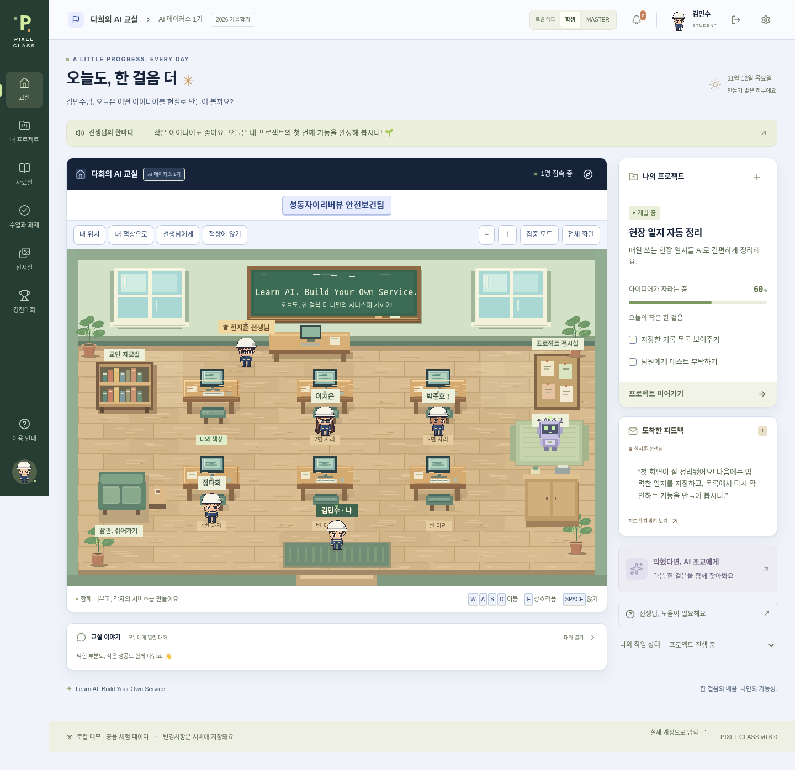

# Pixel Class v0.6

> **운영 품질·반별 경진대회 main 반영 — [PR #13](https://github.com/dhdh09080/pixel-class/pull/13)**
>
> 사용자 Deploy 적용 후 Railway 실행 코드는 `ad4d62f`이며 새 경진대회·아바타가 포함됩니다. 플랫폼 SUCCESS를 확인했지만 외부 계정 로그인·WSS 인수는 현재 검사 환경의 네트워크 차단으로 미완료입니다. [최종 보고서](PRODUCTION_FINAL_REPORT.md) · [경진대회 사용법](COMPETITION_FINAL_REPORT.md) · [검증 현황](STATUS.md)

**Learn AI. Build Your Own Service.**

건설현장 팀원들이 AI로 자신만의 서비스를 만드는 픽셀 메타버스 학교입니다. 교실에서 걷고, 자기 책상을 열어 프로젝트를 진행하고, MASTER에게 질문과 피드백을 주고받습니다. 주요 UI는 한국어입니다.



## 빠르게 실행하기

Node.js **24 이상**과 npm이 필요합니다. 저장소 루트에서 실행하세요.

```sh
npm ci
npm run dev
```

브라우저에서 **http://localhost:5173**을 여세요. API는 `127.0.0.1:3001`입니다. 개발 프록시가 API와 WebSocket을 같은 출처로 연결합니다.

설정이 없는 개발 실행은 **로컬 데모**입니다. 첫 접속은 학생 체험 계정이며 상단 **학생 / MASTER** 버튼으로 역할을 바꿀 수 있습니다. 체험 계정의 변경사항은 같은 로컬 서버의 접속자에게 공유됩니다. 실제 교육 데이터는 데모에 입력하지 마세요.

- WASD / 방향키: 이동
- 빈 바닥 클릭: 가구를 우회하는 A* 자동 이동
- 교실 도구막대: 내 위치·내 책상·선생님 이동, 확대/축소·집중 모드·전체 화면
- 마우스 휠: 교실 확대/축소
- 책상 클릭 또는 가까이에서 E: 프로젝트 / 공개 프로필 열기
- 책상 근처에서 SPACE: 앉기 / 일어나기
- 책장: 자료실, 게시판: 전시실, 보라색 로봇: AI 조교
- 사이드바 아래 / 모바일 하단 내 모습: 외모 수정
- 모바일 방향키: 누르는 동안 이동, 손을 떼거나 모달을 열면 정지

v0.2는 **30명 이상 수용하는 확장 교실**, 기술 구성·맞춤 로드맵, 질문 답변·최종 제출 검토를 추가했습니다. [V02_REPORT.md](V02_REPORT.md)에 변경사항과 검증 범위를 정리했습니다.

v0.3은 동시 편집 보호·파일/피드백/알림의 원자적 저장, 모바일 터치 교실, 상담 우선순위와 프로젝트 다음 행동, 디자인 토큰·모달·접근성을 보완했습니다. [최종 보고서](V03_FINAL_REPORT.md), [디자인 전후 비교](V03_DESIGN_COMPARISON.md), [검증 기록](V03_TEST_REPORT.md)을 확인하세요. 외부 공개 서비스나 Supabase 전환 완료 버전은 아닙니다.

v0.4는 비공개 학교 배포 점검·학교 전체 AI 사용 한도·v0.3 DB 업그레이드/롤백 보존·독립 네트워크 클라이언트·모바일/노트북 조건 검사를 추가합니다. [릴리스 보고서](V04_RELEASE_REPORT.md), [배포 방식 결정](deploy/ARCHITECTURE_DECISION.md), [실제 두 컴퓨터 인수 절차](deploy/RELEASE_CHECKLIST.md)를 확인하세요. **비공개 Railway 교실은 https://pixel-class-private-test.up.railway.app/ 입니다.**

v0.5는 Railway 단일 서버·영구 Volume·비공개 HTTP/WSS 접근 제한·비특권 실행·안전한 DB 초기화/복원을 추가합니다. **2026-11-10 실제 배포는 SUCCESS이며 <https://pixel-class-private-test.up.railway.app>에서 실행 중입니다.** 500MB `/app/data` Volume을 유지합니다. 현재 플랫폼 고정 소스와 main의 수업 기능은 다를 수 있으므로 [STATUS.md](STATUS.md)의 실행 커밋과 검증 범위를 확인하세요. 현재 Codex의 outbound 정책 때문에 외부 두 계정 인수는 미완료이며 공개 운영은 보류합니다. [운영 절차](deploy/railway/README.md) · [배포 보고서](V05_RAILWAY_REPORT.md).

## 할 수 있는 일

- 60×80 정수 도트 레이어 캐릭터, 안전모·직업 모자15종과 의상25종·직업 코디17종, 이름표
- 그림 카드로 고르는 이름·체형·피부·헤어·눈·눈썹·표정·입·장식, 모자 색상/패턴과 의상 색상, 4방향 실시간 미리보기
- 학생 개인 프로젝트 생성·수정·삭제, 할 일·진행률·개발 기록·질문·검토 요청
- 프로젝트별 서비스 형태·필요 기술·난이도(모르면 비워두기), 학생과 MASTER가 편집하는 로드맵
- 구조적인 작업 기록·질문 상태와 답변·개인 알림, 주제별 피드백과 반영 상태
- 제출 당시 설명/링크/파일을 보존하는 최종 검토, 수정 요청·재제출·승인
- 프로젝트별 비공개 첨부파일(각 5MB, 최대 10개)
- MASTER 통합 현황·답변 대기·7일간 작업 기록 없음·학생별 상담
- 7일 유효한 1회용 입학 KEY, 계정 등록, 빈 책상 자동 배정
- 학적 변경과 처리자·사유·날짜 기록, 휴학·복학·졸업·권한 회수
- 교실 WebSocket 이동 동기화·접속 표시·채팅, MASTER 전체/개별 공지
- 교안 검색·업로드·새 버전·다운로드, PDF/이미지 별도 탭 미리보기·TXT/MD 안전한 원문 미리보기
- 승인된 공개 프로젝트 전시
- 프로젝트 맥락과 민감정보 제외 패턴을 사용하는 OpenAI 조교 연결 코드, 미설정 안내, 대화/오류 저장, 호출 제한
- 편집하고 복사하는 Codex 지시문 템플릿 (실제 AI 생성과 구분)
- 교안 기술 주제 태그와 프로젝트 필요 기술에 맞는 규칙 기반 추천
- 향후 Windows 캐릭터 앱이 사용할 개인 이벤트 피드와 수신 확인 API

현재 제공되는 저장소는 **SQLite 기반 단일 서버**입니다. Supabase Auth/Postgres/Realtime/Storage 연동은 구현하지 않았습니다. 서버 API를 통하지 않고 DB를 공개하지 않으며, 모든 데이터 접근에 서버에서 학교·계정·역할·학적·소유권을 검사합니다. [STATUS.md](STATUS.md)에 완료/부분 구현/미구현을 구분했습니다.

## 나만의 비공개 학교 만들기

데모 계정과 실제 계정은 별도 DB를 사용합니다. 실행 중인 데모 서버를 종료하고:

```sh
npm run setup:private
npm run dev
```

1. 로컬에 생성된 `.env`의 `MASTER_BOOTSTRAP_KEY` 값을 확인합니다. 비밀 파일이므로 Git에 넣지 않습니다.
2. 첫 화면의 **MASTER 등록**에서 KEY, 이름, 이메일, 10자 이상 비밀번호를 입력합니다.
3. MASTER는 **교무실 → 입학 초대**에서 KEY/링크를 발급합니다. KEY 원문은 발급 직후에만 보입니다.
4. 학생은 링크에서 자기 계정과 캐릭터를 등록합니다. 프로젝트가 없어도 입장할 수 있습니다.
5. MASTER 등록 후 부트스트랩 KEY를 서버 설정에서 제거해도 됩니다. 이미 등록된 MASTER를 다시 만들 수 없습니다.

설정 도구는 기존 `.env`를 덮어쓰지 않습니다. 기존 파일이 있다면 `DEMO_MODE=false`, `DATABASE_PATH=data/school.sqlite`, 임의의 충분히 긴 `MASTER_BOOTSTRAP_KEY`를 직접 설정하세요. 데모 DB를 비공개 학교로 잘못 사용하는 경우 서버가 시작을 거부합니다.

이 로컬 인증은 이메일 주소를 로그인 식별자로 사용합니다. 본인 비밀번호 변경과 MASTER가 발급하는 30분 유효·1회용 학생 복구 링크를 제공합니다. **이메일 소유권 인증, 이메일 자동 복구, MFA, OAuth는 없습니다.** 외부 공개 운영 전에는 관리형 인증으로 전환하거나 해당 기능과 운영 보안을 보강해야 합니다.

## 데이터와 백업

- 데모 기본 DB: `data/demo.sqlite`
- 비공개 학교 기본 DB: `data/school.sqlite`
- `.env`의 `DATABASE_PATH`로 변경 가능
- 계정·캐릭터·프로젝트·피드백·파일·학적 이력·초대 해시·세션이 DB에 저장됩니다.
- SQLite WAL 모드입니다. 실행 중인 DB 파일 하나만 복사하지 마세요. 서버를 중단한 뒤 DB 및 관련 파일을 백업하거나 SQLite의 일관된 백업 기능을 사용하세요.
- 브라우저 새로고침이나 서버 재시작으로 데이터가 사라지지 않습니다. 개발 서버의 환경 자체가 삭제되는 경우는 별도 백업이 필요합니다.
- 프로젝트 진행률은 기존 할 일과 로드맵 단계의 완료율입니다. 접속/PC 사용 시간과 무관합니다.
- 기존 6개 책상 좌표와 v0.1 프로젝트를 유지하며 확장합니다. 3열×40행 자동 슬롯을 제공하고 교실 높이를 저장합니다. 30명 실제 API 입학·30개 소켓 시뮬레이션·30명 이상 캐릭터의 단일 브라우저를 검증했습니다. 30개 실제 브라우저/사무용 노트북 부하를 검증한 것은 아닙니다.
- `data/`, `.env`, 테스트 산출물은 Git에서 제외됩니다.

## AI 조교 연결

`.env` 또는 서버 환경 변수에 `OPENAI_API_KEY`, `OPENAI_MODEL`을 설정하고 서버를 다시 실행하세요. `OPENAI_MODEL`은 계정에서 접근할 수 있는 Responses API 지원 모델을 지정합니다. 키를 `VITE_` 변수로 만들지 마세요.

서버가 OpenAI Responses API를 호출합니다. 프로젝트 기술 구성·막힌 문제·최근 작업과 최근 대화 최대 10개를 보내며 원격 저장을 끄도록 요청합니다. 개인별 분당 5회, UTC 날짜 기준 일일 20회, 응답당 최대 1,200 출력 토큰, 30초 타임아웃을 적용합니다. 호출 실패도 일일 횟수에 포함됩니다. 실제 비용 상한은 공급자 계정에서도 별도로 설정하세요.

전송 전 비밀키/토큰/비밀번호 형태·이메일·전화번호 및 알려진 서버 비밀 값을 제외합니다. 이 패턴 검사는 모든 민감정보 탐지를 보장하지 않으므로 실제 자료를 점검하세요. AI는 상황·추천 방법·기술과 이유·다음 작업·Codex 예시·MASTER 확인의 6개 항목으로 답하도록 지시합니다.

API 키가 없을 때는 허구의 AI 답변을 보여주지 않습니다. 현재 Cloud 환경에는 키가 없어 **실제 모델 호출은 검증하지 않았습니다**. OpenAI API 접속을 허용하는 네트워크도 필요합니다. AI는 참고 조언이며 MASTER 피드백 및 실제 코드 검토와 구분됩니다.

## 검증

```sh
npm run typecheck
npm run build
npm test
npm run test:e2e
npm run format:check
# 실제 배포 호스트의 비공개 설정 사전 점검(읽기 전용)
npm run deploy:check -- --env-file /srv/pixel-private/compose.env
# 격리된 실제 계정 6개, 기본 10분 반복 검사 (로컬 3020 포트)
npm run test:soak
# 별도 루프백 서버 3021에서 30개 인증 소켓·60초 이동 부하
npm run test:load
# Docker 이미지 빌드 후 비공개 HTTPS/복원 통합 검사
docker build -t pixel-class:ops-test .
npm run test:operations
npm run test:railway
```

Playwright는 이 Cloud 환경의 `/usr/bin/chromium`을 사용합니다. 없으면 `npx playwright install chromium`으로 설치한 브라우저를 사용하며 `CHROMIUM_PATH`로 직접 지정할 수도 있습니다. 테스트는 임시 DB와 별도 포트(3011/3014/3015: API, 3012/5174: 브라우저, 3013: 프로덕션)를 사용합니다. PostgreSQL 전환 준비 SQL은 네트워크 연결 없이 PGlite에서 검증합니다. 실제 Supabase 검증과는 다릅니다.

검증 범위와 결과는 [STATUS.md](STATUS.md)를 확인하세요. Playwright HTML 보고서는 `playwright-report/`, 실패 시 추적 파일은 `test-results/`에 저장됩니다. 실제 계정 운영 검사의 trace는 비활성화하며 비밀 값은 커밋하지 않습니다.

## 빌드와 배포

```sh
npm run build
NODE_ENV=production DEMO_MODE=false DATABASE_PATH=/persistent/school.sqlite \
  PUBLIC_ORIGIN=https://class-test.example.com COOKIE_SECURE=true npm start
```

프로덕션 모드는 Express가 `dist/`를 직접 제공합니다. 정확한 `PUBLIC_ORIGIN`, Secure 쿠키, 명시적인 지속 DB 경로가 없으면 시작을 거부합니다. 최초 MASTER 키는 32자 이상이며 서버 전용 파일 secret으로도 읽습니다. 프로덕션에서는 데모 로그인 API가 비활성화됩니다. HTTP 예외는 `ALLOW_INSECURE_LOCALHOST=true`와 루프백 호스트/출처를 모두 지정한 자동 테스트에만 허용합니다.

[deploy/README.md](deploy/README.md)에 접근 암호로 보호된 Docker/Compose/Caddy 운영 절차와 백업·복원·AI 연결 방법이 있습니다. 실제 로컬 컨테이너 HTTPS에서 MASTER/학생 계정, 데이터 보존과 복원을 검증했습니다. 비공개 Railway 교실은 https://pixel-class-private-test.up.railway.app/ 입니다. 기본 외부 포트는 루프백에만 바인딩하며 실제 호스트에서 도메인·접근 제한을 확인해야 합니다.

현재 서버는 **지속적인 디스크와 WebSocket을 지원하는 단일 Node.js 호스트**가 필요합니다. HTTPS 역방향 프록시 뒤에서 `COOKIE_SECURE=true`, `PUBLIC_ORIGIN=https://실제-도메인`을 설정하고 WebSocket 업그레이드를 전달하세요. 단일 프로세스용 메모리 요청 제한과 로컬 디스크 저장이므로 여러 인스턴스로 그대로 복제하지 마세요.

**현재 형태를 Vercel 정적 사이트/일반 함수에 그대로 배포하면 저장과 WebSocket이 동작하지 않습니다.** Vercel 배포를 위해서는 별도 지속 백엔드 또는 Supabase 데이터·인증·스토리지·실시간 어댑터 전환이 선행되어야 합니다. [supabase/README.md](supabase/README.md)에 준비 SQL과 전환 검증 절차를 정리했습니다. 기존 Supabase 프로젝트는 변경하지 않았습니다. Railway의 지속 디스크를 사용하는 비공개 교실로 운영합니다.

## 구조와 후속 개발

- `src/`: 한국어 React UI, 인증·프로젝트·교무실·자료실
- `src/game/`: Phaser 교실, 충돌, 이동·보간, 직접 제작한 픽셀 맵/레이어 캐릭터
- `server/`: Express API, 학습/교실 서비스, 세션·초대·권한, SQLite 저장소 어댑터, WebSocket, OpenAI 호출
- `shared/`: 공통 타입·유효성 검증·로드맵/프롬프트·A*·충돌·웹/데스크톱 이벤트 계약
- `tests/`: 서버 통합 및 Playwright 흐름 테스트
- `docs/`: 브라우저에서 촬영한 데스크톱/모바일 스크린샷

전체 구조와 Supabase/Tauri 확장 방향은 [ARCHITECTURE.md](ARCHITECTURE.md)를 참고하세요. 가구와 캐릭터는 코드로 직접 그렸으며 외부 게임 에셋을 복제하지 않았습니다.

## 오늘 교육 시작하기 (v0.6)

아래는 main에 구현된 기능입니다. 실제 서비스에 해당 릴리스가 배포됐는지 [STATUS.md](STATUS.md)에서 먼저 확인하세요.

1. 온라인 교실에서 인계받은 공용 접근 암호와 선생님 계정으로 로그인합니다. 실제 전달·검증되지 않은 테스트 계정이나 PC 안내 파일을 가정하지 않습니다. 소유자 계정 인계 절차와 적용 상태는 [MASTER_HANDOFF.md](MASTER_HANDOFF.md)를 확인하세요.
2. **교무실 → 입학 초대 → 여러 학생 초대 링크 한 번에 만들기**에서 필요한 인원(기본 8명)을 발급합니다. 각 학생에게 서로 다른 링크 하나와 공용 접근 암호를 전달합니다. 링크는 7일 유효·1회용이며 원문은 발급 화면에서만 표시합니다.
3. 학생은 자기 이름·이메일·10자 이상 비밀번호를 입력하고 4개 캐릭터 스타일 중 하나를 선택하거나 세부 외모를 꾸민 뒤 입학합니다. 책상과 캐릭터가 계정에 저장됩니다.
4. 학생들이 입학한 뒤 **수업과 과제 → 새 과제 배정하기**에서 재학생 전체 또는 한 학생에게 제목·안내·마감일을 배정합니다. 마감일 입력과 표시는 **Asia/Seoul** 기준입니다. 배정 당시의 학생 목록을 보존하므로 이후 입학생에게는 별도 과제를 배정합니다.
5. 학생은 **수업과 과제**에서 내용과 결과물 링크를 제출합니다. 늦은 제출도 받으며 지각 여부를 기록합니다. 선생님은 미제출/제출/지각/확인 인원을 확인하고 **학생별 제출물과 피드백**에서 확인 또는 보완 요청을 남깁니다. 수정본은 재제출할 수 있고 충돌 시 기존 입력을 보존합니다.
6. 기존 **프로젝트 지도·개발 기록·질문·제출 스냅샷·교안·실시간 채팅·학적 관리**를 함께 사용합니다.
7. 학생이 비밀번호를 잊으면 **교무실 → 학생과 학적 → 학생 비밀번호 복구**에서 본인 확인 후 링크를 발급합니다. 새 링크는 이전 링크를 취소하고, 사용 시 기존 로그인 세션을 철회합니다. 선생님 비밀번호는 **내 계정과 운영**에서 현재 비밀번호를 확인한 뒤 변경합니다.
8. **내 계정과 운영**에서 저장 사용량과 최근 백업을 보고 **학교 백업 내려받기**로 PC에도 보관합니다. 다운로드는 현재 학교만 포함하고 세션·복구 KEY를 제외하며, SQLite VACUUM으로 다른 학교의 삭제된 페이지도 제거합니다. 파일에는 비공개 교육 기록과 비밀번호 해시가 있으므로 안전하게 보관합니다.

첨부파일은 파일당 5MiB·프로젝트당 10개, 학교 전체 저장 레코드 합계는 **120MiB**로 제한합니다. Base64와 교안 과거 버전도 합계에 포함합니다. 디스크 여유가 64MiB보다 작아질 위험이 있으면 추가 업로드를 거부해 기존 데이터를 보존합니다. 계정·텍스트 기록은 별도로 저장됩니다.

운영 모드는 시작 시와 6시간마다 일관성 검사를 통과한 서버 백업 1개를 교체 보관합니다. 백업 공간 부족/실패 시 이전 백업을 유지합니다. **같은 Volume의 백업이므로 외부 재해 복구를 대신하지 않습니다.** PC 다운로드 또는 별도 외부 백업이 필요합니다. 학교 백업은 기존 `scripts/database.mjs verify/restore`로 검증하고 새 파일명에 복원합니다. `AUTO_BACKUP=false`로 주기 실행을 끌 수 있습니다.

OpenAI 키/모델은 설정하지 않았으며 AI 자동 상담은 비활성입니다. 교육 관리·가입·캐릭터·프로젝트·과제 기능은 AI 호출 없이 동작합니다.

## 캐릭터와 학교 이름 꾸미기

오른쪽 위 프로필 또는 왼쪽 아래 캐릭터를 눌러 **교실 속 나의 모습**을 엽니다. 드롭다운 대신 헤어·얼굴·체형·모자·의상 카테고리의 그림 카드와 색상 버튼으로 선택합니다. 헤어18종·체형4종·눈10종·눈썹5종·표정6종·입6종·얼굴 장식10종·피부색8종·눈 색상12종, 모자15종·패턴6종·의상25종을 제공합니다. 모자를 벗고 헤어를 볼 수도 있으며 기존 흰 안전모/남색 작업복도 유지됩니다. 저장한 모습은 같은 계정의 교실과 프로필에 반영됩니다.

기본 학교 이름은 **다희의 AI 교실**입니다. MASTER는 **교실 제목 옆 연필 → 학교와 교실 이름** 또는 **⚙ 내 계정과 운영**에서 학교 이름·기수 이름·교실 이름·학기 표시를 수정합니다. 저장 후 학생 화면에도 반영되고 새로고침/재시작 후 유지됩니다. 학생은 이 설정을 변경할 수 없습니다.

변경 전후 화면과 검사 결과는 [CHARACTER_STUDIO_REPORT.md](CHARACTER_STUDIO_REPORT.md)에 기록합니다. 실제 배포 상태는 [STATUS.md](STATUS.md)를 확인하세요.

이전 아트 시안 기록(현재 원본 아님):2026-11-11 캐릭터는 둥근 머리·볼과 작은 눈, 얇은 원형 안경, 부드러운 앞머리·의상 실루엣으로 다시 다듬었습니다. 저장한 외모 옵션은 그대로 유지합니다. [새 모습과 변경 전후 비교](ROUND_CHARACTER_REPORT.md).

이전192×256 미세 도트 시안은 새 저해상도 아트 지시에 맞게60×80 정수 도트로 교체했습니다. 큰 머리·작은 몸, 양쪽 눈과 홍채 하이라이트,1px 외곽선, 제한된 평면 팔레트를 사용하고 기존55.2×73.6 게임 크기와 외모 ID를 보존합니다. **헤어 → 추천 스타일**7개는 피부/체형을 유지하며, **의상 → 직업 코디**17개는 헤어/얼굴/피부도 그대로 두고 옷과 모자만 바꿉니다. 성별 제한 없이 다시 조합하고 저장/취소할 수 있습니다. [새 실제 렌더링과 검토](PRODUCTION_DESIGN_REVIEW.md).

## 반별 AI 서비스 경진대회

1. MASTER가 **경진대회 → 반과 학생 관리**에서 반을 만들고 학생을 배정합니다. 기존 학생은 기본반을 사용합니다. 일반 교실/프로젝트를 새 반마다 자동으로 분리하는 기능은 아닙니다. 대회·행사·심사 자료의 반별 접근을 구분합니다.
2. **새 경진대회**에서 반·참가자·한국 시간 일정·공개 범위·수상 명칭을 정하고 초안 저장 후 개최합니다. 기본은 초대 심사자만 작품을 보는 방식입니다.
3. 학생은 자기 프로젝트를 연결하고 결과 URL 또는 파일, 소개서 템플릿 또는 HTML, 공개 범위 동의를 제출합니다. 심사 시작 전에는 버전별 수정/철회가 가능하고, 이후 최종 제출물이 고정됩니다.
4. MASTER가 심사자별 KEY/링크를 발급합니다. 링크는 `/competition/<대회ID>#judge=<KEY>` 형식이며 원문 KEY는 발급 직후에만 보입니다. **공용 학교 접근 암호나 학교 계정을 심사자에게 전달하지 않습니다.**
5. 심사자는 심사 기간에 KEY로 한 번 연결하고 지정 작품마다 한 번 평가합니다. 실용성35·활용성30·완성도20·창의성15, 평균·최소 심사 수·동점 기준을 서버가 적용합니다. 종료/발표 시각 후 MASTER가 결과를 명시적으로 공개합니다.
6. KEY는 재활성화할 수 없으므로 모든 평가를 마친 후 심사 연결을 종료하세요. 연결을 잃었다면 MASTER가 기존 평가를 확인하고 미평가 작품만 범위로 정해 새 KEY를 발급합니다. 복원 후에는 모든 심사 KEY/세션이 무효화되고 기존 점수는 보존됩니다.

소개서 원본은 첨부 다운로드로만 제공합니다. 미리보기는 정제된 텍스트·표를 불투명 iframe에서 표시하고 스크립트·이미지·외부 리소스를 제거합니다. 화면 이미지는 허용된 결과 파일로 따로 제출할 수 있습니다. 파일당5MiB, 학교 합계120MiB 제한을 공유하며 실행 파일은 기본 허용하지 않습니다. 악성코드 검사·점수 정정/재심사 UI는 미구현입니다.

교실에는 자기 반 행사 배너·게시판·트로피가 표시되고, 보관하면 제거됩니다. 데이터 구조와 공개/학교 접근 경계는 [COMPETITION_ARCHITECTURE.md](COMPETITION_ARCHITECTURE.md), 실제 검사와 제한은 [COMPETITION_TEST_REPORT.md](COMPETITION_TEST_REPORT.md)를 확인하세요.
